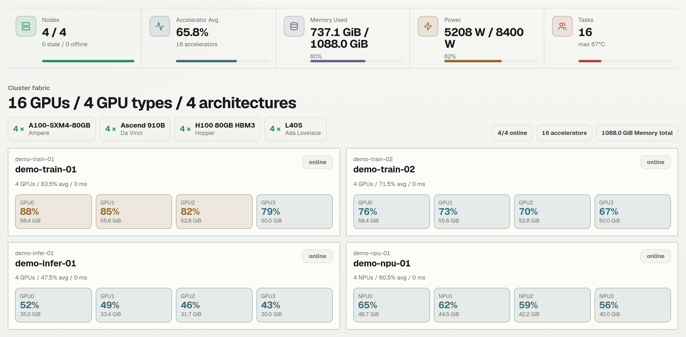
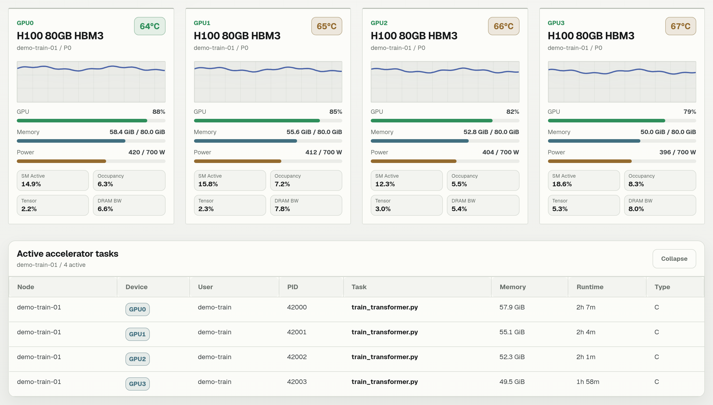
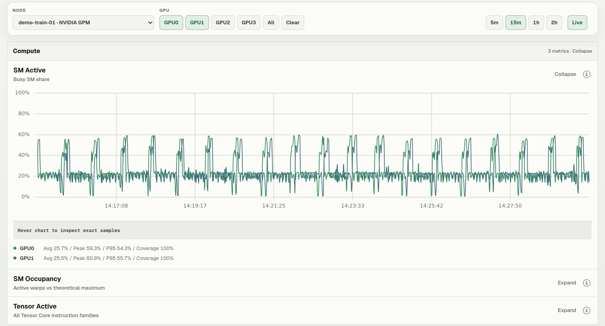
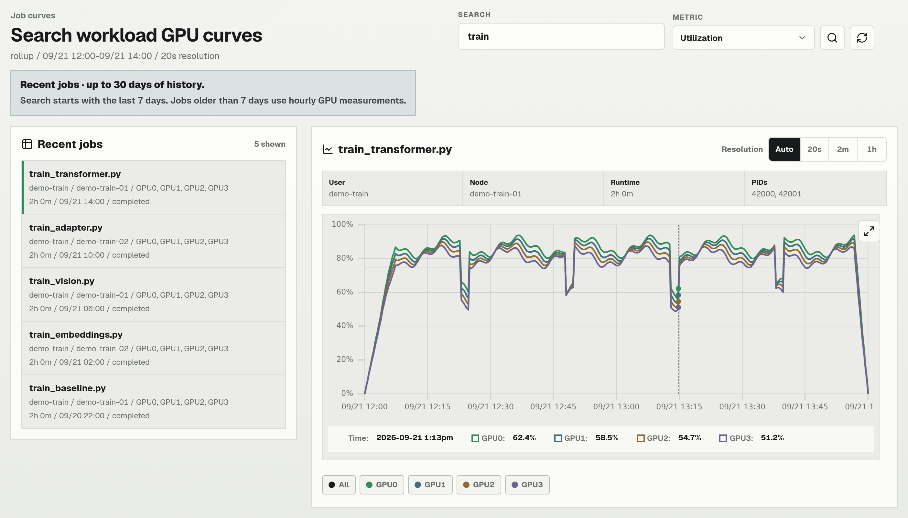
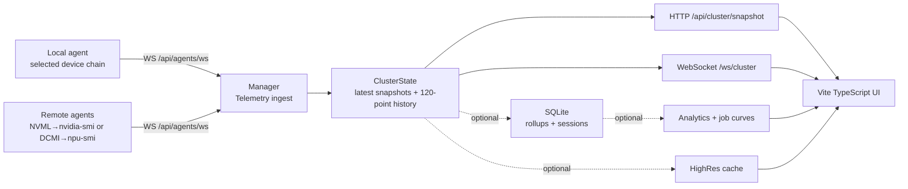

<p align="center">
  
</p>

<h1 align="center">Constella</h1>

<p align="center">
  <strong>Lightweight Heterogeneous Accelerator Monitoring & Workload History</strong>
</p>

<p align="center">
  Monitor today. Review tomorrow.
</p>

<div align="center" id="constella-badges">

[](https://www.rust-lang.org/)
[](https://docs.nvidia.com/deploy/nvml-api/)
[](https://deepwiki.com/kuma-loong/Constella)

</div>

<p align="center">English | <a href="README_zh.md">简体中文</a></p>

Constella is a lightweight accelerator monitoring platform for labs, AI teams,
and personal compute servers. It natively supports heterogeneous clusters;
version 0.1.5 supports NVIDIA GPUs and Ascend NPUs.

Unlike terminal tools that only show the current state, Constella automatically
records accelerator workload history, making it easy to review completed
training and inference jobs. It supports standalone servers and small clusters
without requiring a heavyweight Prometheus/Grafana stack.

## Preview

<table>
  <tr>
    <td width="50%" valign="top">
      <strong>Cluster overview · heterogeneous accelerator inventory and live resource usage</strong><br>
      <a href="docs/assets/01-cluster-overview.png"></a>
    </td>
    <td width="50%" valign="top">
      <strong>Node detail · GPU telemetry and process ownership</strong><br>
      <a href="docs/assets/02-node-detail.png"></a>
    </td>
  </tr>
  <tr>
    <td width="50%" valign="top">
      <strong>Performance · real SM activity samples compared across GPUs</strong><br>
      <a href="docs/assets/03-performance.png"></a>
    </td>
    <td width="50%" valign="top">
      <strong>Job search · completed workloads and multi-GPU history</strong><br>
      <a href="docs/assets/04-job-search.png"></a>
    </td>
  </tr>
</table>

## Features

**Workload History**

- Automatically record GPU curves for completed workloads.
- Review training and inference jobs from the last 7 days.
- Prefer high-resolution memory cache for recent short jobs, with SQLite rollups for persisted history.

**Accelerator Monitoring**

- Monitor a standalone server or a small GPU cluster from one Web UI.
- Track GPU utilization, memory, power, temperature, clocks, processes, users, PIDs, and command fingerprints.
- On supported NVIDIA GPUs, inspect SM activity, occupancy, aggregate Tensor Core activity,
  DRAM bandwidth, and non-Tensor FP16/FP32/FP64 pipelines through NVML GPM.
- Use NVML with `nvidia-smi` fallback for NVIDIA, and DCMI with `npu-smi`
  fallback for Ascend.

**Multi-User Analytics**

- See user GPU usage rankings, job duration rankings, node trends, and range-aware heatmaps.
- Detect low-utilization reservations.
- Keep realtime monitoring available even when historical analytics are disabled.

**Lightweight Deployment**

- No root privileges, system service, Prometheus, or Grafana required.
- One manager process receives data from local and remote accelerator agents.
- Remote nodes run the Agent binary with their vendor driver/runtime. The Manager uses SSH to deploy the Agent.

## Why Constella?

| Capability | nvitop | Prometheus/Grafana | Constella |
| --- | --- | --- | --- |
| Realtime GPU view | Yes | Yes | Yes |
| Workload history | No | Requires setup | Yes |
| Small cluster view | Limited | Yes | Yes |
| Lightweight setup | Yes | No | Yes |
| Web UI | No | Yes | Yes |
| User/job analytics | No | Custom dashboards | Built in |

Constella sits between terminal monitoring and a full observability stack: more historical and shareable than `nvitop`, but much lighter to deploy than Prometheus/Grafana for a small lab.

## Quick Start

Build the release archives with `./scripts/package/build.sh`, or use a matching set of release archives. Follow the [deployment guide](docs/DEPLOYMENT.md) to install the binaries and configure the Manager and Agent.

From the runtime directory, check the configuration and start the stack.

```bash
bin/stack.sh check
bin/stack.sh start
bin/stack.sh status
```

Open `/overview` on the Manager address. Use `bin/stack.sh stop` to stop the stack. For Ascend, set `CONSTELLA_DEVICE_TYPE=ascend` in the Agent environment.

The TUI uses the same cluster stream as the Web interface. Run `constella-tui --url https://gpu.example.com` with the [PyPI client](docs/PYPI_CLI.md).

## Cluster Mode

List remote nodes in `config/nodes.tsv` with their node IDs, SSH aliases, and accelerator backends. The Manager host uses key-based SSH to distribute Agents using the address in `CONSTELLA_CLUSTER_URL`. The local Agent uses `config/agent.env`.

```bash
bin/stack.sh cluster-start
bin/stack.sh cluster-status
bin/stack.sh cluster-stop
```

The watchdog starts missing remote Agent supervisors while Manager is healthy. See the [deployment guide](docs/DEPLOYMENT.md) for ports, backups, and Tunnel setup.

## Ascend NPU support

Constella uses independent, explicitly selected hardware chains:

- `nvidia`: NVML, then `nvidia-smi` fallback.
- `ascend`: DCMI (`libdcmi.so`), then `npu-smi` fallback.

The DCMI backend exposes AICore and HBM utilization, memory, temperature,
power, PCI identity, driver/DCMI versions, and running-process memory.
Multi-die cards remain visible as one device card per die. The API includes
`card_id`, `die_id`, `card_count`, and `accelerator_count`; rated power and live
power are counted once per physical card, while duplicate PIDs across dies are
counted as one active process.

## Architecture



The manager does not sample GPUs directly. Local and remote nodes both report current sample points through the same agent WebSocket path. SQLite, analytics, and high-resolution job curves are optional side paths and do not block realtime snapshots. See [Design](docs/DESIGN.md) for the full data flow.

## Docs

- [Design](docs/DESIGN.md): architecture, data path, low-overhead strategy, and data contracts.
- [Operations](docs/DEPLOYMENT.md): startup, access, cluster agent management, status, and verification commands.
- [SQLite History](docs/HISTORY.md): persistence, rollups, maintenance, and job curves.
- [NVIDIA GPM Performance](docs/NVIDIA_GPM.md): requirements, metric interpretation, retention, and troubleshooting.
- [Cloudflare Tunnel](docs/CLOUD_TUNNEL.md): domain access without opening an inbound server port.
- [Lab user system](docs/user-system-design-zh.md): Access identity, roles, audit, and multi-node Linux account binding.
- [Lab deployment](docs/LAB_DEPLOYMENT.md): build, environment, rollout, backup, and member onboarding.
- [Node manifest example](docs/nodes.example.yaml): `nodes.yaml` template for remote agents.
- [PyPI CLI](docs/PYPI_CLI.md): installed service, probe, agent, and cluster commands.
- [Packaging](docs/PACKAGING.md): build and safely smoke-test wheel and source distributions.
- [Scripts](scripts/README.md): service, cluster, tunnel, maintenance, and dev script entry points.

## Project Layout

```text
packages/backend/       Manager, Agent, shared protocol, API and WebSocket
packages/lab/           Optional Access-protected lab identity and account-binding edition
packages/web/           Installable production Web assets
packages/tui/           Textual terminal client, theme, and usage notes
src/constella_gpu/      Full-distribution metadata package
frontend/               Vite + TypeScript frontend
scripts/                categorized service, cluster, tunnel, maintenance, and dev scripts
docs/                   design and operations notes
tests/                  unit tests
```

## Development

```bash
uv sync
uv run pytest

cd frontend
npm install
npm run build
```

Frontend dev server:

```bash
cd frontend
npm run dev
```

For a release build, `scripts/package/build.sh` builds the frontend into the Web
and Lab distributions and produces all five wheel/source-distribution pairs.

## API

- `GET /api/health`
- `GET /api/cluster/snapshot`
- `GET /api/settings`
- `PATCH /api/settings`
- `WS /ws/cluster`
- `WS /api/agents/ws`
- `GET /api/history/gpu`
- `GET /api/history/tasks`
- `GET /api/users`
- `GET /api/analytics/overview`
- `GET /api/analytics/node/{node_id}`
- `GET /api/highres/status`
- `GET /api/highres/jobs`
- `GET /api/highres/jobs/{job_key}`
- `GET /api/highres/jobs/{job_key}/gpu`
- `GET /api/highres/performance`
- `GET /api/highres/jobs/{job_key}/performance`
- `GET /api/docs`

When SQLite is not enabled, history, analytics, and job curve search APIs return `enabled:false`; realtime cluster monitoring continues through `/api/cluster/snapshot` and `/ws/cluster`.

## License

[MIT](LICENSE)
