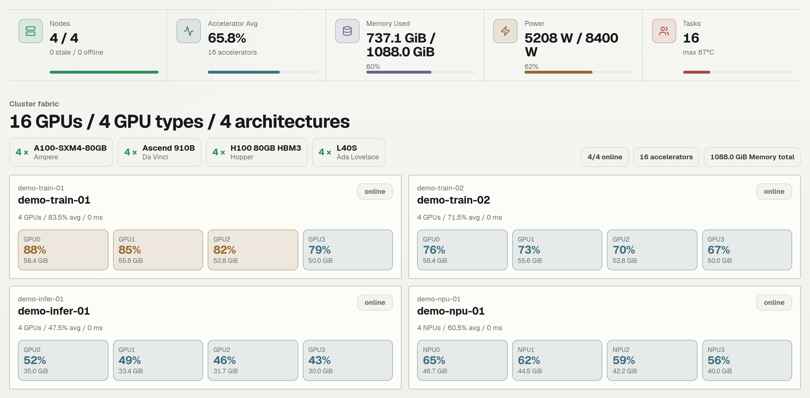
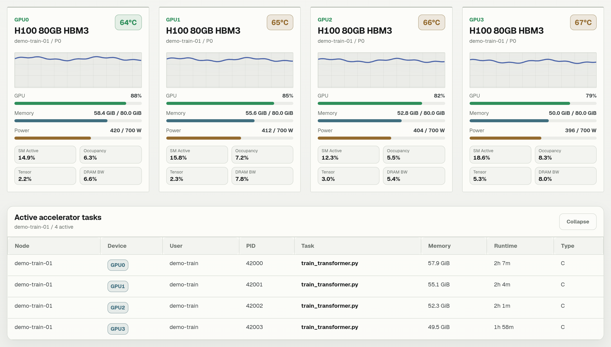
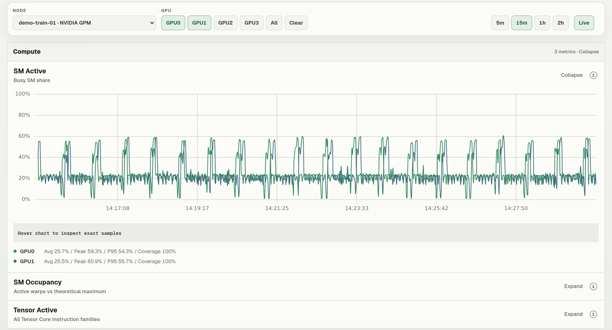
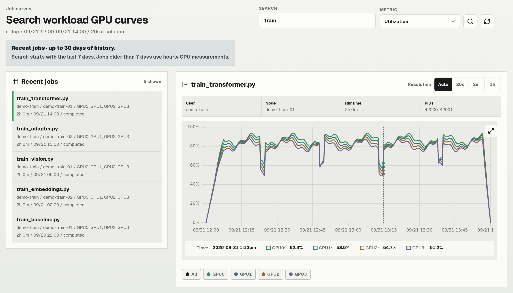
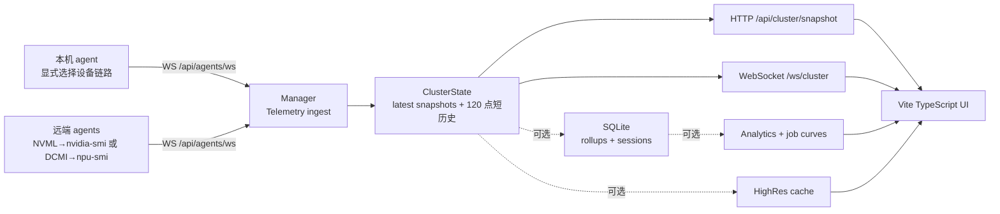

<p align="center">
  
</p>

<h1 align="center">Constella</h1>

<p align="center">
  <strong>轻量级异构加速器集群监控与任务历史追踪</strong>
</p>

<p align="center">
  今天监控，明天复盘。
</p>

<div align="center" id="constella-badges">

[](https://www.python.org/)
[](https://docs.nvidia.com/deploy/nvml-api/)
[](https://deepwiki.com/kuma-loong/Constella)

</div>

<p align="center"><a href="README.md">English</a> | 简体中文</p>

Constella 是一个面向实验室、AI 团队和个人计算服务器的轻量级加速器监控平台，
原生支持多种硬件组成的异构集群；0.1.5 版本支持 NVIDIA GPU 与 Ascend NPU。

不同于只能查看当前状态的终端工具，Constella 会自动记录加速器任务历史，
方便在训练或推理结束后回看曲线。它支持单机和小型异构集群，不需要先部署
一整套 Prometheus/Grafana 监控系统。

## 预览

<table>
  <tr>
    <td width="50%" valign="top">
      <strong>集群概览 · 异构加速器分布与实时资源使用</strong><br>
      <a href="docs/assets/01-cluster-overview.png"></a>
    </td>
    <td width="50%" valign="top">
      <strong>节点详情 · GPU 指标与进程归属</strong><br>
      <a href="docs/assets/02-node-detail.png"></a>
    </td>
  </tr>
  <tr>
    <td width="50%" valign="top">
      <strong>Performance · 多卡真实 SM 活跃度对比</strong><br>
      <a href="docs/assets/03-performance.png"></a>
    </td>
    <td width="50%" valign="top">
      <strong>任务查询 · 已完成任务与多卡历史曲线</strong><br>
      <a href="docs/assets/04-job-search.png"></a>
    </td>
  </tr>
</table>

## 功能

**任务历史追踪**

- 自动记录已完成任务的 GPU 曲线。
- 回看最近 7 天内的训练和推理任务。
- 短任务优先使用高分辨率内存缓存，持久化历史由 SQLite rollup 提供。

**加速器监控**

- 在一个 Web UI 中监控单机或小型 GPU 集群。
- 查看 GPU 利用率、显存、功耗、温度、时钟、进程、用户、PID 和命令指纹。
- 在支持的 NVIDIA GPU 上，通过 NVML GPM 查看 SM 活跃度、占用率、Tensor Core
  合计活跃度、DRAM 带宽以及非 Tensor FP16/FP32/FP64 流水线。
- NVIDIA 优先使用 NVML 并以 `nvidia-smi` 兜底；Ascend 优先使用 DCMI
  并以 `npu-smi` 兜底。

**多用户分析**

- 查看用户 GPU 使用排行、作业用时排行、节点趋势和按时间窗自适应的热力图。
- 检测低利用率占用。
- 即使不启用历史分析，实时监控也可以正常工作。

**轻量部署**

- 不需要 root 权限、system service、Prometheus 或 Grafana。
- 一个 manager 进程接收本机和远端加速器 agent 的数据。
- 远端节点只需要 Python、对应厂商驱动/运行时和 SSH 访问权限。

## 为什么是 Constella？

| 能力 | nvitop | Prometheus/Grafana | Constella |
| --- | --- | --- | --- |
| 实时 GPU 状态 | 支持 | 支持 | 支持 |
| 任务历史追踪 | 不支持 | 需要配置 | 内置 |
| 小型集群视图 | 有限 | 支持 | 支持 |
| 轻量部署 | 支持 | 不轻量 | 支持 |
| Web UI | 不支持 | 支持 | 支持 |
| 用户/作业分析 | 不支持 | 需要自定义看板 | 内置 |

Constella 介于终端监控和完整可观测性系统之间：比 `nvitop` 更适合历史追踪和多人共享，又比 Prometheus/Grafana 更适合小实验室快速部署。

## 快速开始

用 `./scripts/package/build.sh` 构建发布包，或直接使用同版本的发布包。按[部署指南](docs/DEPLOYMENT.md)安装二进制并配置 Manager 和 Agent。

在运行目录检查配置并启动服务。

```bash
bin/stack.sh check
bin/stack.sh start
bin/stack.sh status
```

打开 Manager 地址的 `/overview`。停止整套服务使用 `bin/stack.sh stop`。昇腾节点在 Agent 环境中设置 `CONSTELLA_DEVICE_TYPE=ascend`。

终端客户端和 Web 界面读取同一套集群数据。安装 [PyPI 客户端](docs/PYPI_CLI.md)后可运行 `constella-tui --url https://gpu.example.com`。

## 集群模式

在 `config/nodes.tsv` 中配置远端节点 ID、SSH 别名和采样后端。Manager 主机通过免密 SSH 分发 Agent，远端 Agent 连接 `CONSTELLA_CLUSTER_URL`。本机 Agent 使用 `config/agent.env`。

```bash
bin/stack.sh cluster-start
bin/stack.sh cluster-status
bin/stack.sh cluster-stop
```

Manager 健康时，看门狗负责补启远端缺失的 Agent 守护。端口、备份和 Tunnel 配置见[部署指南](docs/DEPLOYMENT.md)。

## Ascend NPU 支持

Constella 使用两条显式选择、互不串行回退的硬件链路：

- `nvidia`：NVML，失败后回退 `nvidia-smi`。
- `ascend`：DCMI（`libdcmi.so`），失败后回退 `npu-smi`。

DCMI 后端采集 AICore/HBM 利用率、内存、温度、功耗、PCI 标识、驱动/DCMI
版本和进程显存。
双 Die 设备仍按每个 Die 一个卡片展示。API 增加 `card_id`、`die_id`、
`card_count` 和 `accelerator_count`；实时功耗和额定功耗按物理卡只统计一次，
跨 Die 的相同 PID 按一个活跃进程统计。

## 架构



manager 不直接采样 GPU；本机节点和远端节点都通过同一条 agent WebSocket 路径上报当前采样点。SQLite、分析 API 和高分辨率作业曲线都是可选旁路，不阻塞实时快照。完整设计见 [设计说明](docs/DESIGN.md)。

## 文档

- [设计说明](docs/DESIGN.md)：架构、数据路径、低开销策略和数据契约。
- [运维手册](docs/DEPLOYMENT.md)：启动、访问、集群 agent 管理、状态和验证命令。
- [SQLite 历史库](docs/HISTORY.md)：持久化、rollup、维护和作业曲线。
- [NVIDIA GPM 性能监控](docs/NVML_GPM_METRICS_zh.md)：支持条件、指标解读、数据保留和故障排查。
- [Cloudflare Tunnel](docs/CLOUD_TUNNEL.md)：无入站端口的域名访问方案。
- [节点清单示例](docs/nodes.example.yaml)：远端 agent 的 `nodes.yaml` 模板。
- [PyPI CLI](docs/PYPI_CLI.md)：安装包的 service、probe、agent 和 cluster 命令。
- [打包说明](docs/PACKAGING.md)：构建并安全烟测 wheel 和源码包。
- [脚本说明](scripts/README.md)：service、cluster、tunnel、maintenance、dev 脚本入口。

## 项目结构

```text
packages/backend/       Manager、Agent、共享协议、API 和 WebSocket
packages/lab/           Lab 鉴权、账户、绑定与审计
packages/web/           可安装的生产 Web 静态资源
packages/tui/           Textual 终端客户端、主题与使用说明
src/constella_gpu/      完整发行包的元数据包
frontend/               Vite + TypeScript 前端
scripts/                按 service、cluster、tunnel、maintenance、dev 分类的脚本
docs/                   设计和运维文档
tests/                  单元测试
```

## 开发

```bash
uv sync
uv run pytest

cd frontend
npm install
npm run build
```

前端开发模式：

```bash
cd frontend
npm run dev
```

发布时运行 `scripts/package/build.sh`，它会把前端构建到 Web 发行包中，并生成
四组 wheel 与源码包。

## API

- `GET /api/health`：服务健康状态。
- `GET /api/cluster/snapshot`：当前集群快照。
- `GET /api/settings`：当前运行时设置。
- `PATCH /api/settings`：更新全局刷新率。
- `WS /ws/cluster`：实时集群快照流。
- `WS /api/agents/ws`：agent 上报通道。
- `GET /api/history/gpu`：可选 GPU 历史指标。
- `GET /api/history/tasks`：可选任务历史。
- `GET /api/users`：可选用户任务聚合。
- `GET /api/analytics/overview`：可选 Overview 历史分析。
- `GET /api/analytics/node/{node_id}`：可选节点历史曲线和热力图。
- `GET /api/highres/status`：高分辨率内存缓存状态。
- `GET /api/highres/jobs`：作业搜索。
- `GET /api/highres/jobs/{job_key}`：作业详情。
- `GET /api/highres/jobs/{job_key}/gpu`：作业 GPU 曲线。
- `GET /api/highres/performance`：NVIDIA GPM 高精度性能曲线和区间统计。
- `GET /api/highres/jobs/{job_key}/performance`：作业所在设备的性能曲线。
- `GET /api/docs`：FastAPI OpenAPI 文档。

未启用 SQLite 时，历史、分析和作业曲线搜索 API 返回 `enabled:false`；实时集群监控仍然通过 `/api/cluster/snapshot` 和 `/ws/cluster` 工作。

## License

[MIT](LICENSE)
